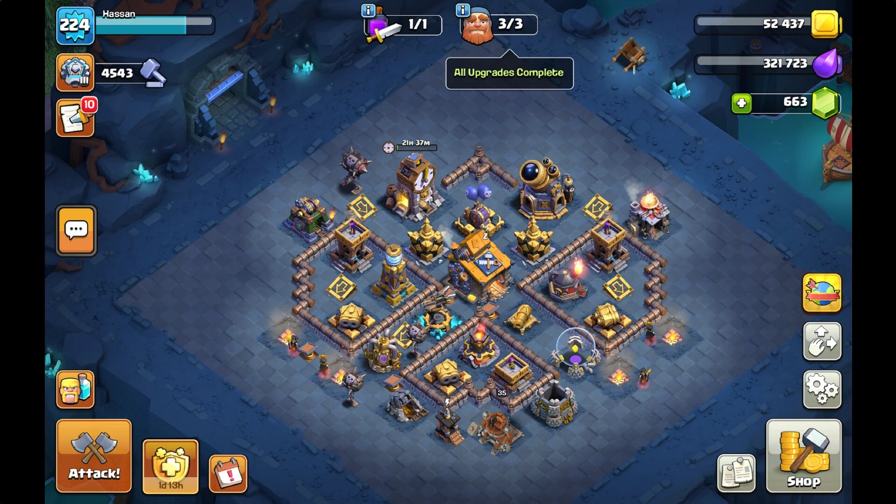
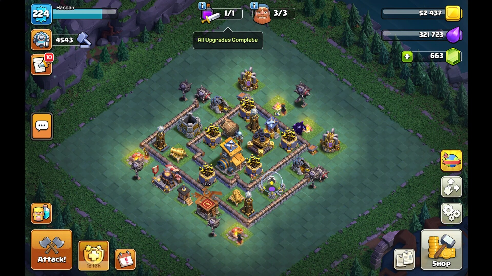

# 🏆 Builder Base: Maxed Out

### Hassan · Experience Level 224

**Every building, wall, trap and troop in the Builder Base fully upgraded.**

---

## 📸 The proof

### Stage 1: Builder Hall village

> Builders **3/3** and Star Laboratory **1/1** both show **"All Upgrades Complete"**.

### Stage 2: O.T.T.O's Outpost

> The second battle stage is maxed too: same **"All Upgrades Complete"** banner.

---

## 📊 Snapshot at the time of maxing

| Stat | Value |
| --- | --- |
| 👤 Player | **Hassan** |
| ⭐ Experience level | **224** |
| 🏆 Builder Base trophies | **4,543** |
| 🔨 Builders | **3 / 3**, all upgrades complete |
| 🧪 Star Laboratory | **1 / 1**, all upgrades complete |
| 🪙 Gold | 52,437 |
| 💧 Elixir | 321,723 |
| 💎 Gems | 663 |

---

## 🌐 Showcase page

There is also a standalone showcase page in [`index.html`](index.html).
To put it online, turn on **GitHub Pages** for this repository
(*Settings → Pages → Deploy from a branch*, pick the branch and `/ (root)`).

*Grind complete. Nothing left to build.* 🛠️

